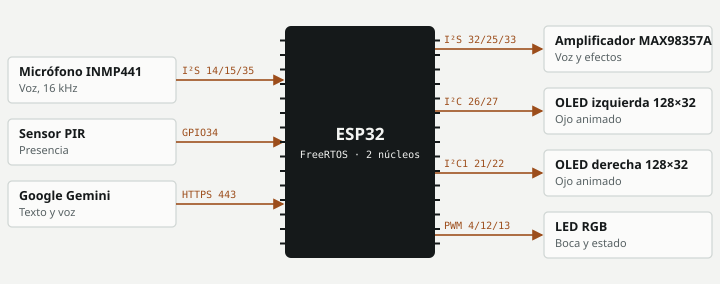
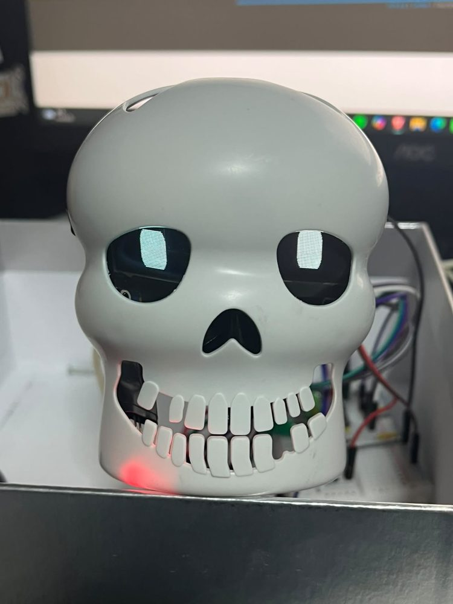

# Calaverita parlante con IA

Una calavera con ESP32 que detecta voz con un micrófono I²S, envía la frase a Google Gemini por HTTPS, reproduce la respuesta hablada y anima dos ojos OLED; sin internet responde con audios grabados.

**Estado:** En desarrollo · **Periodo:** oct 2026 · **Autor:** Daniel Ignacio Pedraza Martínez

## Objetivo

Construir un personaje interactivo de Día de Muertos que funcione como asistente de voz con palabra clave, y que siga funcionando sin conexión.

## Arquitectura

Una tarea FreeRTOS fijada al núcleo 0 lee el micrófono, decide si hay voz, graba la frase y reproduce audio. El lazo principal anima los ojos, controla el LED y atiende comandos por puerto serie. Con Wi-Fi, la frase grabada se envía como WAV a Gemini, que responde texto; luego se pide la voz y se reproduce. Sin Wi-Fi, usa audios embebidos.



## Hardware

| Componente | Función | Conexión |
|---|---|---|
| ESP32 DevKit (clásico) | Controlador y Wi-Fi | — |
| Micrófono INMP441 | Captura de voz | `I²S SCK 14 · WS 15 · SD 35` |
| Amplificador MAX98357A + bocina | Reproducción | `I²S BCLK 32 · LRC 25 · DIN 33` |
| 2 OLED SSD1306 0.91" 128×32 | Ojos | `Wire 26/27 y Wire1 21/22 a 400 kHz` |
| Sensor PIR | Saluda al detectar a alguien | `GPIO34` |
| LED RGB | Boca al ritmo de la voz | `GPIO 4/12/13` |

## Firmware y protocolos

- **Captura.** I²S a 16 kHz; elimina componente DC, aplica ganancia y submuestrea a 8 kHz para enviar
- **Detección de voz.** Nivel por desviación media; umbral = máx(300, ruido × 3); el ruido se adapta cuando nadie habla
- **Grabación.** Búfer circular con 0.4 s previos a la voz y máximo 5 s por frase
- **Cliente HTTPS.** Petición POST construida a mano, lectura de respuestas chunked y respaldo de DNS a 8.8.8.8
- **Respuesta.** Si el modelo responde NADA, la frase no iba dirigida a la calavera y se ignora; si no, se pide la voz y se reproduce a 24 kHz

## Funcionamiento

- Al arrancar mide 1.5 s de ruido ambiente antes de escuchar.
- Detecta el inicio de una frase, la graba incluyendo 0.4 s previos y la envía como WAV.
- Mientras espera la respuesta, los ojos miran hacia arriba y el LED cambia de color.
- Después de hablar, ignora el micrófono 700 ms para no escucharse a sí misma.
- Seis expresiones de ojos (normal, enojado, feliz, sospechoso, sorprendido, dormido) controlables por puerto serie para depuración.

## Decisiones técnicas

- **Audio en una tarea aparte.** La lectura I²S bloqueante no congela la animación de los ojos.
- **Umbral adaptativo.** Se recalcula solo cuando no hay voz, para que el ruido del lugar no dispare grabaciones.
- **Pre-grabación de 0.4 s.** Evita cortar la primera sílaba de la frase.
- **Modo sin conexión.** Respuestas pregrabadas cuando no hay Wi-Fi o falla la API.

## Problemas y soluciones

| Problema | Solución |
|---|---|
| Fallos de DNS del router | Si no resuelve el servidor, cambia a DNS 8.8.8.8 y 1.1.1.1 y reintenta. |
| Respuestas HTTP por partes | Lector propio de transferencia chunked. |
| La calavera se escuchaba a sí misma | Ventana de 700 ms en la que ignora el micrófono tras hablar. |

## Fotografías

  
*Calaverita ensamblada: ojos en dos pantallas OLED y LED rojo de boca (16 oct 2026).*

🎥 [Video del ciclo de respuesta (21 s)](docs/respuesta.mp4): mientras piensa, LED morado y ojos hacia arriba; al contestar, LED rojo de boca al ritmo de la voz.

🎥 [Video de demostración (15 s)](docs/demo.mp4): ojos animados y LED de boca reaccionando.

## Estructura del repositorio

```
v1-sin-conexion/calavera_prueba/   reacciona a la voz con audios embebidos (audios.h)
v2-gemini/calavera_prueba/         palabra clave + Gemini por HTTPS + voz generada
docs/diagrama.svg
```

## Cómo compilar

1. Arduino IDE 2 con el paquete **esp32 de Espressif** (placa *ESP32 Dev Module*).
2. Instala las librerías listadas abajo desde el gestor de librerías.
3. Si la carpeta del sketch tiene `secrets.example.h`, cópialo como `secrets.h` y llena tus datos.
4. Abre el `.ino` de la versión que quieras y súbelo.
5. La clave de Gemini se obtiene en Google AI Studio. Sin clave, la versión 2 funciona como la 1.

**Librerías:** Adafruit SSD1306, Adafruit GFX (I²S y Wi-Fi vienen con el core de ESP32)

## Evolución

- **asistente_esp32_gemini · ago 2026:** Primer asistente de voz: ESP32 con INMP441, OLED y LED RGB conectado a Gemini.
- **calavera_prueba:** Versión sin conexión: reacciona a voz con audios grabados y ojos animados.
- **calavera_prueba2 · oct 2026:** Añade Wi-Fi, Gemini, palabra clave y voz generada.

## Limitaciones

- Depende de un servicio externo y de la calidad de la red para entender la voz.
- El cliente HTTPS no valida el certificado (setInsecure).
- La clave de la API está en el código; debe salir del firmware antes de publicarlo.

## Mejoras futuras

- Medir latencia extremo a extremo y tasa de aciertos de la palabra clave.
- Detección de palabra clave local para no enviar audio innecesario.
- Mover la clave a un servidor intermedio en lugar del dispositivo.

---
Parte del [portafolio técnico](https://github.com/nshtpdrz) de Daniel Ignacio Pedraza Martínez · Ingeniería en Tecnologías de la Información y Comunicaciones, Tecnológico Nacional de México, Campus Pachuca.
