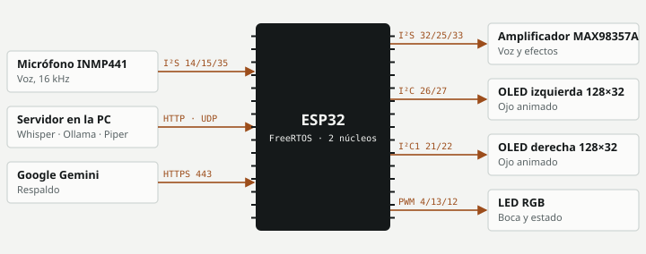
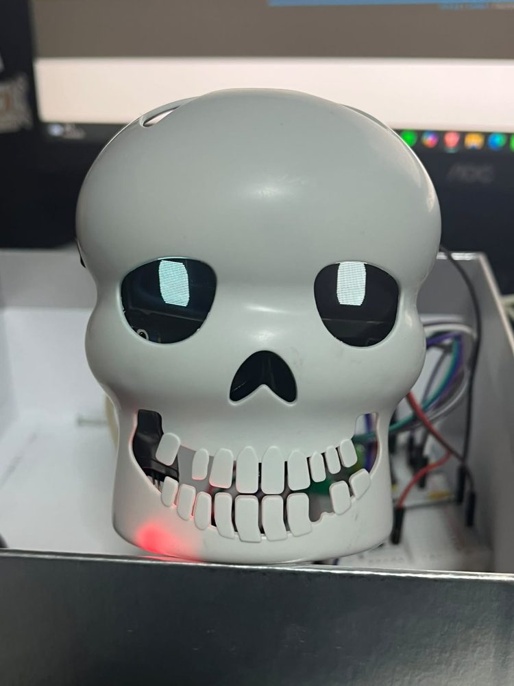

# Calaverita parlante con IA

Una calavera con ESP32 que detecta voz con un micrófono I²S y envía la frase por Wi-Fi a un servidor en la PC que la transcribe con Whisper, genera la respuesta con un modelo de lenguaje local (gemma3:4b en Ollama) y la convierte en voz con Piper; la calavera la reproduce mientras anima dos ojos OLED. Si la PC no está disponible, usa Gemini como respaldo.

**Estado:** Funcional · **Periodo:** ago – oct 2026 · **Autor:** Daniel Ignacio Pedraza Martínez

## Objetivo

Construir un personaje interactivo de Día de Muertos que funcione como asistente de voz con palabra clave, con el procesamiento de lenguaje corriendo en una computadora local y respaldo en la nube.

## Arquitectura

El sistema se divide en dos partes. En el ESP32, una tarea FreeRTOS fijada al núcleo 0 lee el micrófono, detecta voz, graba la frase y reproduce audio, mientras el lazo principal anima los ojos y controla el LED. En la PC, un servidor HTTP en Python recibe el WAV, lo transcribe con faster-whisper, verifica la palabra clave, genera la respuesta con un modelo local en Ollama y la sintetiza con Piper, aplicando tono grave y eco. El servidor se anuncia cada 2 s por difusión UDP para que la calavera encuentre su IP sin configuración. Si la PC no responde, la calavera envía la frase a Gemini por HTTPS.



## Hardware

| Componente | Función | Conexión |
|---|---|---|
| ESP32 DevKit (clásico) | Controlador y Wi-Fi | — |
| Micrófono INMP441 | Captura de voz | `I²S SCK 14 · WS 15 · SD 35` |
| Amplificador MAX98357A + bocina | Reproducción | `I²S BCLK 32 · LRC 25 · DIN 33` |
| 2 OLED SSD1306 0.91" 128×32 | Ojos | `Wire 26/27 y Wire1 21/22` |
| LED RGB | Boca al ritmo de la voz | `R 4 · G 13 · B 12` |
| Computadora con Windows | Servidor de voz y modelo de lenguaje local | `Misma red Wi-Fi` |

## Firmware y protocolos

- **Captura.** I²S a 16 kHz; elimina componente DC, aplica ganancia y submuestrea a 8 kHz; búfer circular con 0.4 s previos a la voz y máximo 4 s por frase
- **Detección de voz.** Umbral adaptativo al ruido ambiente, nivel mínimo y duración mínima de 800 ms para descartar golpes
- **Descubrimiento.** La PC difunde "CALAVERA_PC 8000" por UDP cada 2 s; la calavera guarda la IP y el puerto
- **Servidor (Python).** ThreadingHTTPServer: POST /preguntar recibe el WAV y devuelve PCM de 16 bits con cabeceras X-Frecuencia y X-Texto; 204 si no le hablaban
- **Voz a texto.** faster-whisper (modelo base, int8 en CPU) en español, con normalización de volumen
- **Palabra clave.** Coincidencia aproximada (difflib ≥ 0.75) sobre 1 a 3 palabras unidas, para tolerar errores de transcripción
- **Modelo de lenguaje.** gemma3:4b en Ollama con personalidad definida por prompt de sistema y memoria de los últimos 4 turnos
- **Texto a voz.** Piper con la voz es_MX-claude-high; tono grave (reproducción al 85 %) y eco calculado con NumPy
- **Respaldo.** Si la PC falla, petición HTTPS a Gemini: transcribe y responde, y luego genera la voz

## Funcionamiento

- En la PC se ejecuta iniciar_cerebro.bat: carga Whisper, la voz de Piper y el modelo de Ollama, y empieza a anunciarse en la red.
- Al arrancar, la calavera mide 1.5 s de ruido ambiente y escucha los anuncios UDP hasta encontrar el servidor.
- Detecta el inicio de una frase, la graba incluyendo 0.4 s previos y la envía como WAV al servidor.
- Si la frase no menciona "Calavera", el servidor responde 204 y la calavera la ignora.
- Mientras espera la respuesta, los ojos miran hacia arriba y el LED se pone morado; al hablar, el LED rojo sigue el ritmo de la voz.
- Después de hablar, ignora el micrófono 700 ms para no escucharse a sí misma.
- El servidor guarda las últimas 5 grabaciones con su nivel de pico, promedio y saturación para ajustar el micrófono.

## Decisiones técnicas

- **Procesamiento en una PC local.** Whisper, Ollama y Piper corren sin costo ni límite de peticiones; Gemini queda solo como respaldo.
- **Descubrimiento por UDP.** Evita escribir la IP de la PC en el firmware: la calavera la encuentra sola en la red.
- **Audio en una tarea aparte.** La lectura I²S bloqueante no congela la animación de los ojos.
- **Palabra clave en el servidor.** La transcripción completa permite reconocer "Calavera" aunque Whisper la escriba mal.
- **Pre-grabación de 0.4 s.** Evita cortar la primera sílaba de la frase.
- **Respuesta en PCM crudo.** El ESP32 reproduce el audio mientras llega, sin decodificar ni guardar el archivo completo.

## Problemas y soluciones

| Problema | Solución |
|---|---|
| Límite de uso de la API gratuita | Se movió el procesamiento a un servidor local con Whisper, Ollama y Piper; Gemini queda como respaldo. |
| La calavera no sabía la IP de la PC | Anuncio UDP periódico del servidor y descubrimiento automático en el ESP32. |
| Whisper escribía mal la palabra clave | Comparación aproximada con difflib uniendo de 1 a 3 palabras. |
| Grabaciones con volumen bajo | Normalización del audio en el servidor y registro de pico y saturación de cada grabación. |
| La calavera se escuchaba a sí misma | Ventana de 700 ms en la que ignora el micrófono tras hablar. |
| Fallos de DNS del router | Si no resuelve el servidor de Gemini, cambia a DNS 8.8.8.8 y 1.1.1.1 y reintenta. |

## Fotografías

  
*Calaverita ensamblada: ojos en dos pantallas OLED y LED rojo de boca (16 oct 2026).*

🎥 [Video del ciclo de respuesta (21 s)](docs/respuesta.mp4): mientras piensa, LED morado y ojos hacia arriba; al contestar, LED rojo de boca al ritmo de la voz.

🎥 [Video de demostración (15 s)](docs/demo.mp4): ojos animados y LED de boca reaccionando.

## Estructura del repositorio

```
v1-sin-conexion/calavera_prueba/   reacciona a la voz con audios embebidos (audios.h)
v2-gemini/calavera_prueba/         palabra clave + Gemini por HTTPS + voz generada
v3-final-cerebro-pc/calavera_pc/   versión final: busca el servidor en la red (UDP) y Gemini como respaldo
v3-final-cerebro-pc/servidor_calavera/  servidor en Python: Whisper + Ollama (gemma3:4b) + Piper
docs/diagrama.svg
```

## Cómo compilar

1. Arduino IDE 2 con el paquete **esp32 de Espressif** (placa *ESP32 Dev Module*).
2. Instala las librerías listadas abajo desde el gestor de librerías.
3. Si la carpeta del sketch tiene `secrets.example.h`, cópialo como `secrets.h` y llena tus datos.
4. Abre el `.ino` de la versión que quieras y súbelo.
5. La clave de Gemini se obtiene en Google AI Studio. Sin clave, la versión 2 funciona como la 1.

### Servidor en la PC (versión final)

1. Instala [Ollama](https://ollama.com) y Python 3.
2. En `v3-final-cerebro-pc/servidor_calavera/`: `pip install -r requirements.txt`.
3. Ejecuta `iniciar_cerebro.bat` (o `python cerebro_pc.py`). La primera vez descarga Whisper, la voz de Piper y el modelo gemma3:4b.
4. Conecta la PC y la calavera a la misma red Wi-Fi y enciende la calavera: encuentra el servidor sola.

**Librerías:** Adafruit SSD1306, Adafruit GFX (I²S y Wi-Fi vienen con el core de ESP32)

## Evolución

- **asistente_esp32_gemini · ago 2026:** Primer asistente de voz: ESP32 con INMP441, OLED y LED RGB conectado a Gemini.
- **calavera_prueba:** Versión sin conexión: reacciona a voz y a un sensor PIR con audios grabados y ojos animados.
- **calavera_prueba2 · oct 2026:** Añade Wi-Fi, Gemini, palabra clave y voz generada.
- **calavera_pc + servidor_calavera · oct 2026:** Versión final: Whisper, modelo local en Ollama y Piper en la PC, descubrimiento UDP y Gemini como respaldo.

## Limitaciones

- Necesita la PC encendida y en la misma red para usar el modelo local.
- Algunas redes de invitados bloquean la comunicación entre dispositivos y el descubrimiento UDP.
- El cliente HTTPS del respaldo no valida el certificado (setInsecure).

## Mejoras futuras

- Medir la latencia de cada etapa (transcripción, modelo y voz) y la tasa de aciertos de la palabra clave.
- Detección de palabra clave en el ESP32 para no enviar audio innecesario.
- Ejecutar el servidor en una Raspberry Pi o mini PC dedicada.

---
Parte del [portafolio técnico](https://github.com/nshtpdrz) de Daniel Ignacio Pedraza Martínez · Ingeniería en Tecnologías de la Información y Comunicaciones, Tecnológico Nacional de México, Campus Pachuca.
